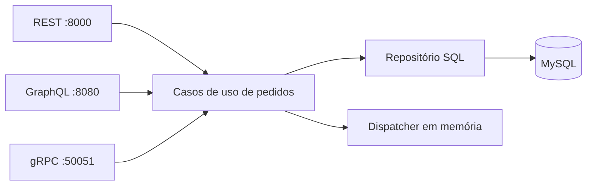

# Clean Architecture com Go — laboratório de pedidos

Projeto de estudo com operações de pedidos expostas por **REST, GraphQL e gRPC**, usando MySQL e um dispatcher de eventos em memória. O código explora separação entre entidades, casos de uso e adaptadores de infraestrutura; **não é uma aplicação de produção**.

## Componentes



O Docker Compose também inicia um RabbitMQ para estudos. **A aplicação atual não registra um consumidor/publicador RabbitMQ em `cmd/main.go`**; a presença do serviço no Compose não comprova entrega de eventos na fila. O dispatcher existente é local ao processo, sem garantia de persistência ou reprocessamento.

## Execução local

Este exemplo pressupõe Go compatível com `go.mod`, Docker Compose e `golang-migrate` instalado. **Use somente em máquina e rede locais isoladas**. O Compose limita as portas do MySQL e RabbitMQ a `127.0.0.1`, mas não substitui firewall, suporte de segurança ou autenticação da aplicação. O MySQL 5.7 foi mantido por compatibilidade com o exercício e está fora de suporte; consulte [SECURITY_SETUP.md](SECURITY_SETUP.md).

1. Na raiz, copie [`.env.example`](.env.example) para `.env` e substitua as senhas de exemplo por valores locais únicos (os valores precisam ser configurados no `.env` local; `docker compose config --quiet` valida a sintaxe, não a presença de todos os segredos):

   ```bash
   cp .env.example .env
   # Edite .env; nunca publique as credenciais
   docker compose config --quiet
   docker compose up -d
   ```

2. Copie [`cmd/.env.example`](cmd/.env.example) para `cmd/.env`. Configure `DB_USER=root`, `DB_PASSWORD` com a **mesma senha** de `MYSQL_ROOT_PASSWORD` em `.env`, e mantenha `DB_HOST=localhost` e `DB_PORT=3306` para uso pelo Go no host. Os arquivos `.env` são ignorados pelo Git.

3. Instale o `golang-migrate` e configure `MIGRATE_DATABASE_URL` no ambiente do shell, usando a senha local do MySQL com os caracteres especiais codificados conforme a sintaxe de URL da ferramenta. O Makefile **não possui mais credenciais fixas**:

   ```bash
   # Exemplo de formato; substitua pelo valor local correto no seu shell:
   export MIGRATE_DATABASE_URL='mysql://root:<SENHA_LOCAL_CODIFICADA>@tcp(127.0.0.1:3306)/orders'
   make migrate
   ```

   Não copie uma senha verdadeira para comandos, arquivos ou históricos que serão compartilhados. Evite executar `make migratedown` se precisar preservar dados. A pasta persistida em `.docker/mysql` pode conter dados de versões anteriores: mudar o `.env` não redefine a senha de uma instância MySQL já inicializada.

4. Inicie a aplicação a partir do diretório `cmd`:

   ```bash
   cd cmd
   go run .
   ```

`LoadConfig(".")` procura opcionalmente o arquivo `cmd/.env` e aceita todas as configurações por variáveis de ambiente. Variáveis de ambiente têm precedência sobre o arquivo, e campos essenciais ausentes retornam erro. A função não imprime senhas nos erros de configuração.

## Interfaces disponíveis no código

| Interface | Acesso local | Observações |
| --- | --- | --- |
| REST | `http://localhost:8000/order`, `/list-orders` | Exemplos em [`api/`](api/) |
| GraphQL | `http://localhost:8080/` | Playground com queries e mutations do schema |
| gRPC | `localhost:50051` | `OrderService` com criação e listagem |

As portas são configuráveis. Os servidores atuais não implementam autenticação ou autorização.

## Testes e qualidade

```bash
go test -race ./...
go vet ./...
go build ./...
```

O [workflow Go CI](.github/workflows/go.yml) executa essas verificações e formatação a cada pull request e push na `main`. Os testes automatizados atuais cobrem domínio, repositório SQLite e dispatcher local; **não comprovam um cenário integrado de MySQL, RabbitMQ e todos os protocolos**.

## Limitações relevantes

- As portas do MySQL e RabbitMQ são publicadas somente em loopback e as senhas não estão mais fixas no Compose ou no Makefile. **MySQL 5.7 continua sem suporte** e as demais limitações de produção permanecem.
- Os servidores REST, GraphQL e gRPC agora verificam o bind das três portas antes de iniciar, observam falhas de execução e tratam SIGINT/SIGTERM com encerramento coordenado. HTTP usa timeout de cabeçalhos e espera limitada a 10 segundos por requisições em andamento; o gRPC usa `GracefulStop` com fallback `Stop`. Esses testes verificam bind ocupado e requisição HTTP em andamento, **não** demonstram disponibilidade contínua, cobertura de todas as falhas nem desligamento durante chamadas gRPC reais.
- Integração RabbitMQ com confirmação, tratamento de falhas, retry e outbox não está conectada à execução principal.
- Valores monetários estão representados por `float32` no domínio: adequado para reproduzir o exercício original, **não uma recomendação para cálculo financeiro real**.
- Falta cobertura de integração de todos os protocolos e políticas de autenticação, autorização e exposição de rede.

A proposta deste repositório é demonstrar aprendizado arquitetural com escopo e evidências explícitos, sem alegar robustez de produção.
