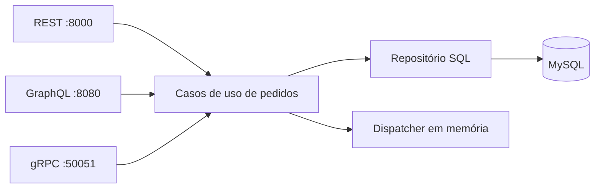

# Clean Architecture com Go — laboratório de pedidos

Projeto de estudo com operações de pedidos expostas por **REST, GraphQL e gRPC**, usando MySQL e um dispatcher de eventos em memória. O código explora separação entre entidades, casos de uso e adaptadores de infraestrutura; **não é uma aplicação de produção**.

## Componentes



O Docker Compose também inicia um RabbitMQ para estudos. **A aplicação atual não registra um consumidor/publicador RabbitMQ em `cmd/main.go`**; a presença do serviço no Compose não comprova entrega de eventos na fila. O dispatcher existente é local ao processo, sem garantia de persistência ou reprocessamento.

## Execução local

Este exemplo pressupõe Go compatível com `go.mod`, Docker Compose e `golang-migrate` instalado. Os serviços de infraestrutura usam configurações demonstrativas antigas e **não devem ser expostos a redes não confiáveis**. Consulte [SECURITY_SETUP.md](SECURITY_SETUP.md) antes de iniciar os contêineres.

1. Revise `docker-compose.yaml` e configure credenciais locais descartáveis antes de iniciar MySQL e RabbitMQ. O arquivo versionado mantém valores demonstrativos.
2. Inicie os serviços apenas em ambiente isolado:

   ```bash
   docker compose up -d
   ```

3. Crie `cmd/.env` a partir de [`cmd/.env.example`](cmd/.env.example), preenchendo as variáveis do banco. **Não versione `.env`**.
4. Execute as migrações na raiz usando a ferramenta `migrate`. **Atenção:** o [Makefile](Makefile) atual contém credenciais demonstrativas fixas, portanto adapte o comando/conexão ao seu ambiente antes de executá-lo.
5. Inicie o programa com o diretório de trabalho `cmd`:

   ```bash
   cd cmd
   go run .
   ```

`LoadConfig(".")` procura opcionalmente o arquivo `cmd/.env` e aceita todas as configurações por variáveis de ambiente. Variáveis de ambiente têm precedência sobre o arquivo, e campos essenciais ausentes retornam erro. A função não imprime senhas nos erros de configuração.

## Interfaces disponíveis no código

| Interface | Acesso local | Observações |
| --- | --- | --- |
| REST | `http://localhost:8000/order`, `/list-orders` | Exemplos em [`api/`](api/) |
| GraphQL | `http://localhost:8080/` | Playground com queries e mutations do schema |
| gRPC | `localhost:50051` | `OrderService` com criação e listagem |

As portas são configuráveis. Os servidores atuais não implementam autenticação ou autorização.

## Testes e qualidade

```bash
go test -race ./...
go vet ./...
go build ./...
```

O [workflow Go CI](.github/workflows/go.yml) executa essas verificações e formatação a cada pull request e push na `main`. Os testes automatizados atuais cobrem domínio, repositório SQLite e dispatcher local; **não comprovam um cenário integrado de MySQL, RabbitMQ e todos os protocolos**.

## Limitações relevantes

- A configuração de infraestrutura possui exemplos legados, incluindo MySQL 5.7 e credenciais demonstrativas; não são recomendações para produção.
- Servidores HTTP e gRPC ainda precisam de tratamento de erros de inicialização, ciclo de vida e encerramento coordenado.
- Integração RabbitMQ com confirmação, tratamento de falhas, retry e outbox não está conectada à execução principal.
- Valores monetários estão representados por `float32` no domínio: adequado para reproduzir o exercício original, **não uma recomendação para cálculo financeiro real**.
- Falta cobertura de integração de todos os protocolos e políticas de autenticação, autorização e exposição de rede.

A proposta deste repositório é demonstrar aprendizado arquitetural com escopo e evidências explícitos, sem alegar robustez de produção.
